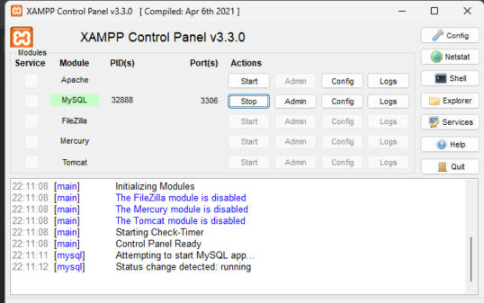
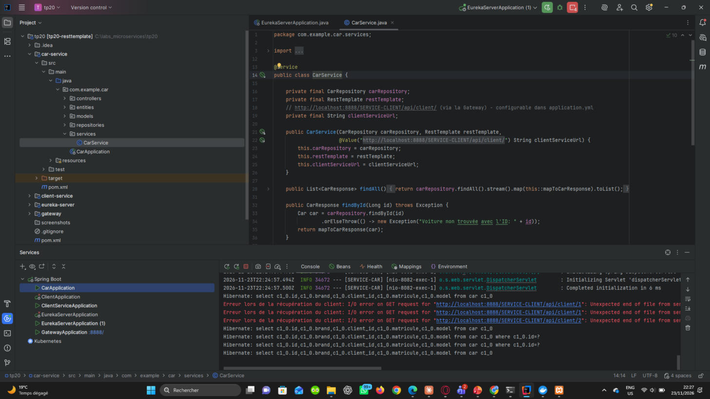
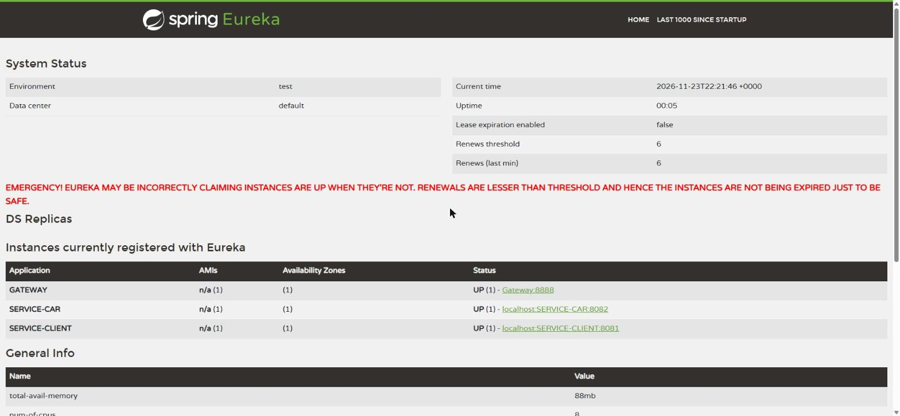
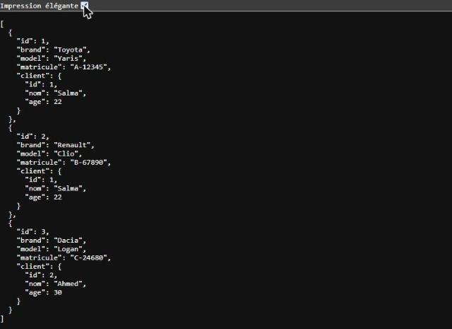
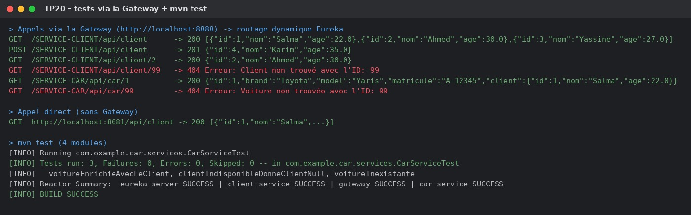

# TP 20 : Architecture microservices avec RestTemplate

Module **Architecture Microservices : conception, déploiement et orchestration**. Lab « TP 20 : Architecture Micro-services avec RestTemplate ».

Le TP met en place une petite architecture microservices complète :
- un **annuaire de services** (Eureka) ;
- une **passerelle** (Spring Cloud Gateway) ;
- deux **microservices métier**, *Client* et *Voiture*, chacun avec sa propre base MySQL.

Le service Voiture appelle le service Client avec **RestTemplate**, en passant par la Gateway, pour renvoyer chaque voiture **enrichie** des informations de son propriétaire.

| Module | Port | Rôle | Dépendances principales |
|---|---|---|---|
| `eureka-server` | 8761 | Service discovery (registre + tableau de bord) | Eureka Server |
| `client-service` | 8081 | CRUD des clients, base `clientservicedb` | Web, Data JPA, MySQL, Eureka Client, Lombok |
| `gateway` | 8888 | Point d'entrée unique, routes dynamiques | Spring Cloud Gateway, Eureka Client, Actuator |
| `car-service` | 8082 | Voitures + appel du service client (RestTemplate), base `carservicedb` | Web, Data JPA, MySQL, Eureka Client, Lombok |

Versions : Java 17, Spring Boot 3.3.5 (3.3.13 pour la gateway, voir § 6), **Spring Cloud 2023.0.6**, MySQL 8 (XAMPP).

---

## 1. Architecture

```
                         ┌───────────────────────┐
                         │  Eureka Server :8761  │◀──── enregistrement (heartbeat 30 s)
                         └──────────▲────────────┘                │
                                    │ registre                    │
 Client HTTP ──▶ ┌──────────────────┴───┐  lb://SERVICE-CLIENT  ┌──┴──────────────────┐
  (navigateur,   │  Gateway :8888       │ ────────────────────▶ │ SERVICE-CLIENT :8081 │──▶ MySQL clientservicedb
   Postman)      │  /SERVICE-XXX/**     │                       └─────────────────────┘
                 │                      │  lb://SERVICE-CAR     ┌─────────────────────┐
                 │                      │ ────────────────────▶ │ SERVICE-CAR :8082    │──▶ MySQL carservicedb
                 └──────────────────────┘                       └──────────┬──────────┘
                            ▲                                              │
                            └──── RestTemplate GET /SERVICE-CLIENT/api/client/{id} ┘
```

Le trajet de `GET http://localhost:8888/SERVICE-CAR/api/car/1` :
1. La Gateway reçoit la requête et lit le nom de service dans l'URL (`SERVICE-CAR`).
2. Elle demande à Eureka où tourne `SERVICE-CAR`, puis transfère la requête vers `http://<ip>:8082/api/car/1`.
3. Le service voiture lit la voiture dans **sa** base (`carservicedb`).
4. Pour remplir le champ `client`, il appelle avec **RestTemplate** `http://localhost:8888/SERVICE-CLIENT/api/client/1`. Cet appel repasse par la Gateway, qui le route vers le service client.
5. Il renvoie un `CarResponse` qui contient la voiture et son client.

## 2. Structure du dépôt

```
tp20/
├── pom.xml                      (POM agrégateur : les 4 modules dans un seul projet IntelliJ)
├── eureka-server/   EurekaServerApplication (@EnableEurekaServer), application.yml
├── client-service/  entities/Client, repositories/ClientRepository, services/ClientService,
│                    controllers/ClientController (/api/client), application.yml (+ application-h2.yml)
├── gateway/         GatewayApplication (DiscoveryClientRouteDefinitionLocator), application.yml
├── car-service/     entities/Car, models/Client (DTO), models/CarResponse (@Builder),
│                    repositories/CarRepository, services/CarService (RestTemplate),
│                    controllers/CarController (/api/car), test CarServiceTest (Mockito)
└── screenshots/
```

---

## 3. Étapes réalisées

### 3.1 Eureka Server
```yaml
server:
  port: 8761
eureka:
  client:
    register-with-eureka: false   # le serveur ne s'enregistre pas lui-même
    fetch-registry: false         # il ne récupère pas de registre : c'est lui le registre
```
```java
@EnableEurekaServer
@SpringBootApplication
public class EurekaServerApplication { ... }
```

### 3.2 Microservice Client (SERVICE-CLIENT, port 8081)
- `spring.application.name: SERVICE-CLIENT` : c'est le nom affiché dans Eureka et utilisé dans les URL de la Gateway.
- `eureka.client.service-url.defaultZone: http://localhost:8761/eureka/` et `prefer-ip-address: true`.
- `Client` (`@Entity` + Lombok `@Data`) avec les champs `id`, `nom`, `age` (Float).
- `ClientRepository extends JpaRepository<Client, Long>`, puis `ClientService` (`findById` avec `orElseThrow`), puis `ClientController` :
  - `GET /api/client` ;
  - `GET /api/client/{id}` (404 si le client n'existe pas) ;
  - `POST /api/client` (201).
- `@EnableDiscoveryClient` sur la classe principale. L'énoncé cite `@EnableEurekaClient`, qui a été **supprimée** dans Spring Cloud 2022+ : `@EnableDiscoveryClient`, ou même aucune annotation, suffit.

### 3.3 Gateway (port 8888)
```yaml
spring:
  cloud:
    gateway:
      discovery:
        locator:
          enabled: true               # une route par service Eureka : /NOM-SERVICE/** -> lb://NOM-SERVICE
          lower-case-service-id: false
management:
  endpoints.web.exposure.include: "health,info,gateway"   # /actuator/gateway/routes
```
Le bean `DiscoveryClientRouteDefinitionLocator`, créé à partir de `ReactiveDiscoveryClient` et `DiscoveryLocatorProperties`, génère ces routes à partir du registre Eureka. La route ajoute le filtre `RewritePath /SERVICE-CAR/(?<remaining>.*) => /${remaining}` : le préfixe est retiré avant l'envoi au service.

### 3.4 Microservice Voiture (SERVICE-CAR, port 8082)
- L'entité `Car` stocke seulement `client_id` (**pas de relation JPA entre microservices** : les bases sont séparées).
- `models.Client` est un **DTO** : un simple objet qui reçoit le JSON du service client. `CarResponse` utilise `@Builder`.
- Le bean **RestTemplate** a des timeouts (`SimpleClientHttpRequestFactory` : 5 s pour la connexion, 5 s pour la lecture).
- `CarService.mapToCarResponse()` fait le travail principal :
```java
Client client = null;
try {
    client = restTemplate.getForObject(clientServiceUrl + car.getClient_id(), Client.class);
} catch (Exception e) {
    // service client indisponible -> client = null, mais pas d'erreur 500
}
return CarResponse.builder().id(car.getId()).brand(car.getBrand())
        .model(car.getModel()).matricule(car.getMatricule()).client(client).build();
```
- L'URL du service client (`http://localhost:8888/SERVICE-CLIENT/api/client/`) est **externalisée** dans `application.yml` (`client-service.url`).

### 3.5 Ordre de lancement
1. MySQL (XAMPP), port 3306.
2. `EurekaServerApplication`.
3. `ClientServiceApplication`.
4. `GatewayApplication`.
5. `CarApplication`.

Dans IntelliJ, les 4 applications se lancent depuis la fenêtre **Services**. Au démarrage, un `CommandLineRunner` insère 3 clients et 3 voitures si les tables sont vides.

---

## 4. Captures d'écran

### MySQL démarré dans XAMPP (port 3306)


### IntelliJ : les 4 microservices lancés dans la fenêtre Services, et `CarService` (RestTemplate)
Les lignes rouges dans la console correspondent au premier lancement de la Gateway, avant la correction de version expliquée au § 6.


### Tableau de bord Eureka : GATEWAY, SERVICE-CAR et SERVICE-CLIENT enregistrés (UP)


### `GET http://localhost:8888/SERVICE-CAR/api/car` : voitures enrichies avec leur client


### Tous les appels (via la Gateway et en direct) et `mvn test`


---

## 5. Résultats obtenus

```
GET  http://localhost:8888/SERVICE-CLIENT/api/client     -> 200 [{"id":1,"nom":"Salma","age":22.0},{"id":2,"nom":"Ahmed","age":30.0},{"id":3,"nom":"Yassine","age":27.0}]
POST http://localhost:8888/SERVICE-CLIENT/api/client     -> 201 {"id":4,"nom":"Karim","age":35.0}
GET  http://localhost:8888/SERVICE-CLIENT/api/client/99  -> 404 Erreur: Client non trouvé avec l'ID: 99
GET  http://localhost:8888/SERVICE-CAR/api/car/1         -> 200 {"id":1,"brand":"Toyota","model":"Yaris","matricule":"A-12345",
                                                                  "client":{"id":1,"nom":"Salma","age":22.0}}
GET  http://localhost:8888/SERVICE-CAR/api/car/99        -> 404 Erreur: Voiture non trouvée avec l'ID: 99
GET  http://localhost:8888/actuator/gateway/routes       -> routes /SERVICE-CAR/**, /SERVICE-CLIENT/**, /GATEWAY/** (uri lb://...)
```
`mvn test` :
- les 4 modules sont en **BUILD SUCCESS** ;
- `CarServiceTest` (Mockito, sans base ni réseau) passe ses **3 tests** :
  - voiture enrichie ;
  - client indisponible → `client = null` ;
  - voiture inexistante.

---

## 6. Problèmes rencontrés et solutions

| Problème | Cause | Solution |
|---|---|---|
| Gateway : `NoSuchMethodError: HttpHeaders.headerSet()` puis « Failed to fetch » sur chaque route | Spring Cloud Gateway 4.1.9 (train 2023.0.6) exige Spring Framework ≥ 6.1.15, alors que Boot 3.3.5 fournit 6.1.14 | Module `gateway` passé sur **Spring Boot 3.3.13** |
| `"client": null` dans les voitures | Conséquence du problème précédent : l'appel RestTemplate via la Gateway échouait | Résolu par la correction ci-dessus |
| Le nom du client restait toujours `null` | L'énoncé déclare le DTO avec `name` / `Integer age`, alors que le service client renvoie `nom` / `age` (Float) | DTO aligné sur le JSON : `nom`, `Float age` |
| `spring-cloud.version 2021.0.4` dans l'énoncé | Ce train correspond à Spring Boot 2.6/2.7 | **2023.0.6** (compatible Boot 3.2 / 3.3) |
| `spring-boot-starter-web` + `spring-cloud-starter-gateway` | La Gateway est **réactive** (WebFlux/Netty) : avec Spring MVC dans le classpath, elle refuse de démarrer | Pas de `starter-web` dans la gateway |
| `@EnableEurekaClient` introuvable | Annotation supprimée dans Spring Cloud 2022+ | `@EnableDiscoveryClient` |
| Bandeau rouge « EMERGENCY! EUREKA MAY BE INCORRECTLY CLAIMING… » | **Mode auto-préservation** d'Eureka : il apparaît quand peu de services sont en ligne (normal en local) | Aucun problème, ou `eureka.server.enable-self-preservation=false` en développement |
| Routes en double dans `/actuator/gateway/routes` | `locator.enabled: true` et le bean `routesDynamic` créent chacun leurs routes | Sans effet fonctionnel. Garder une seule des deux solutions en production |

Si MySQL n'est pas disponible, chaque service a un profil **`h2`** (`application-h2.yml`) qu'on active avec `--spring.profiles.active=h2`.

---

## 7. Résumé du TP

- **Eureka** est l'annuaire : chaque service s'y enregistre sous un nom logique (`spring.application.name`) et envoie un *heartbeat* (signal de vie) toutes les 30 s.
- La **Gateway** est le point d'entrée unique. Avec le *discovery locator*, chaque service est accessible automatiquement sous `http://gateway/NOM-SERVICE/...`, sans écrire de route.
- **Une base par microservice** : la voiture ne garde que `client_id`, et les données du client sont lues par un **appel HTTP**, pas par une jointure JPA.
- **RestTemplate** est le client HTTP **synchrone et bloquant** de Spring (`getForObject`, `postForObject`, `exchange`). Il faut lui configurer des timeouts et gérer l'indisponibilité du service distant.
- Le pattern d'**enrichissement** (ou *API composition*) combine une donnée locale et une donnée distante dans un DTO de réponse (`CarResponse`).

## 8. Fiche QCM

| Question | Réponse |
|---|---|
| Port par défaut d'Eureka | **8761** |
| Annotation du serveur Eureka | `@EnableEurekaServer` |
| `register-with-eureka: false` et `fetch-registry: false` | Le serveur ne s'enregistre pas lui-même et ne récupère pas de registre |
| Propriété qui donne le nom du service dans Eureka | `spring.application.name` |
| URL d'enregistrement d'un client | `eureka.client.service-url.defaultZone=http://localhost:8761/eureka/` |
| `prefer-ip-address: true` | S'enregistre avec son adresse IP plutôt qu'avec le nom d'hôte |
| Annotation côté client (versions récentes) | `@EnableDiscoveryClient` (`@EnableEurekaClient` est obsolète) |
| Port de la Gateway dans le TP | **8888** |
| Routage automatique par Eureka | `spring.cloud.gateway.discovery.locator.enabled=true` |
| Format d'URL via la Gateway | `http://localhost:8888/SERVICE-CLIENT/api/client` |
| Bean qui crée les routes dynamiques | `DiscoveryClientRouteDefinitionLocator` |
| Endpoint Actuator des routes | `/actuator/gateway/routes` |
| Pourquoi pas de `@ManyToOne` entre Car et Client ? | Bases de données séparées : on stocke seulement l'id et on fait un appel REST |
| Rôle de `models.Client` dans le service voiture | **DTO** : il reçoit le JSON, ce n'est pas une entité |
| RestTemplate est… | Synchrone et bloquant (une alternative moderne est WebClient, ou Feign pour le style déclaratif) |
| Méthode RestTemplate pour un GET qui renvoie un objet | `getForObject(url, Client.class)` |
| Pourquoi des timeouts ? | Éviter qu'un service lent ou en panne bloque les threads indéfiniment |
| Service client en panne | Le `try/catch` renvoie `client = null`. En production : Circuit Breaker (Resilience4j) |
| Utilité de `@Builder` (Lombok) | Créer un objet de façon lisible : `CarResponse.builder()...build()` |
| Ports du TP | Eureka 8761, Client 8081, Car 8082, Gateway 8888 |
| Ordre de démarrage | Eureka, puis Client, puis Gateway, puis Car |
